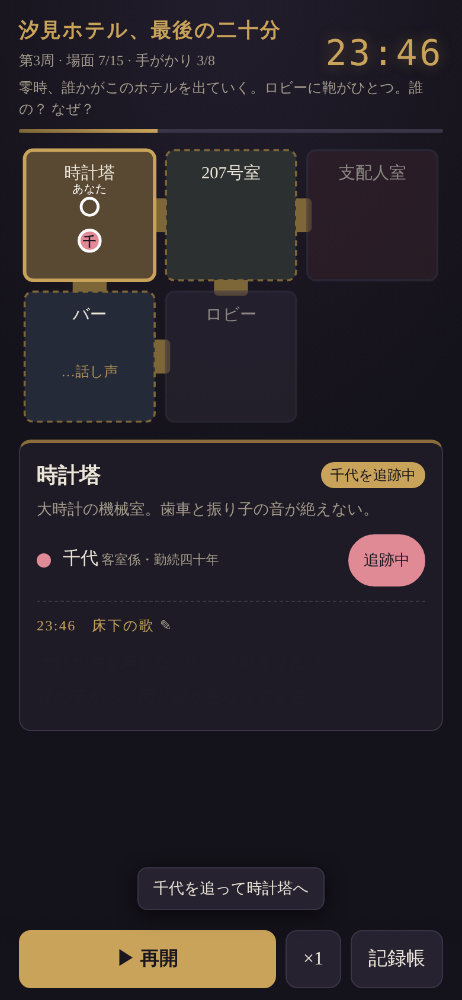
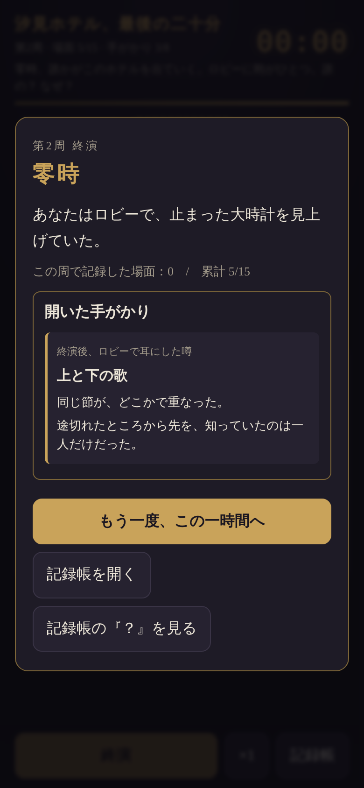
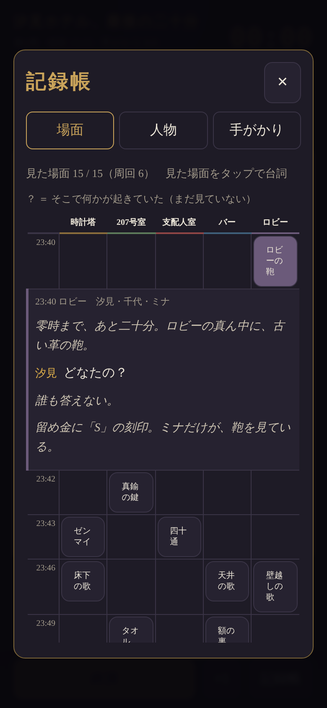

# 汐見ホテル、最後の二十分（仮題）

> **あなたが見ていない部屋で、事件は進んでいる。**

観客が館内を自由に歩き、**どの部屋にいるかで見える物語が変わる**イマーシブシアター形式のブラウザゲーム（試作）。
閉館前夜の古いホテル（架空）の 23:40〜24:00 を何度も繰り返す。冒頭で問いが立つ：

**「零時、誰かがこのホテルを出ていく。ロビーに鞄がひとつ。誰の？ なぜ？」**

- 依存なしの静的 HTML/CSS/JS（スマホ縦優先）。脚本は JSON に分離していて、別の公演を足せる。
- 人物3人・部屋5つ・場面13・手がかり7＋最終章。最短3周で最終章に届く。

## タイトル候補（決定はオーナー）

| # | タイトル | 由来・狙い |
|---|---|---|
| 1 | **止めるのは私** | 終盤、時計塔で千代が振り子に手を添えて言う一言。ポスターに台詞を一行だけ置く型 |
| 2 | **四十一通目** | 汐見の引き出しにある四十通の退職届と、今夜はじめて判を押される一通。数字だけで「何かが終わる」と伝える |
| 3 | **手ぶらで発つ人** | 最終章の答えそのもの。鞄の謎に対する裏切りが題に入っている（ネタバレとの境目） |
| 4 | **汐見ホテル、零時の鞄** | ホテル名と最初の謎の物。いちばん分かりやすい |
| 5 | **床下の歌、天井の歌** | 新規性の一点（同じ瞬間を上と下の部屋から聞く）をそのまま題にした |

キャッチ（案）：「あなたが見ていない部屋で、事件は進んでいる。」

## 遊び方

| 操作 | 内容 |
|---|---|
| 見取り図の隣の部屋をタップ | 移動（扉でつながった部屋のみ） |
| 人物の「追う」 | その人物の移動に自動で付いていく（もう一度押すと解除） |
| ▶ / ❚❚ | 時計を進める / 止める（スペースキーでも可） |
| ×1 / ×2 / ×4 | 速度。場面の最中は自動で等速に落ちる |
| 記録帳 | 場面（時刻×部屋の表）／人物（目撃した居場所）／手がかり・考察メモ |

- 等速で 1 分 = 9 秒、1 周 = 約 3 分。見えるのは自分のいる部屋だけ。隣の部屋で何か起きていると「…話し声」が漏れる。
- 手がかりは**終演時**にまとめて開く。その周に新しい手がかりが無ければ、いちばん進んでいる手がかりが「終演後、ロビーで耳にした噂」として 1 つ開く（成果ゼロの周を作らない）。
- 記録帳の場面タブは時刻×部屋の表。見ていない場面は「？」のマスとして時刻と部屋だけ見えるので、覚えていなくても次の周の行き先を決められる。
- 記録は `localStorage`（この端末のみ）。「進み具合を共有」はネタバレなしの進捗文を共有シート／クリップボードに渡すだけで、外部送信はしない。

## ローカルで動かす

```sh
cd games/immersive-hour
python3 -m http.server 8765
# http://localhost:8765/            通常
# http://localhost:8765/?fast=60    時間を 60 倍速（確認用）
# http://localhost:8765/?s=<id>     公演の切り替え
```

## 構造

```
games/immersive-hour/
├── index.html / style.css / app.js   エンジン（脚本に依存しない）
├── scenarios/
│   ├── index.json                    公演一覧 [{ id, file, title }]
│   └── shiomi-hotel.json             公演「汐見ホテル、最後の二十分」
├── tools/
│   ├── timetable.mjs                 脚本の整合性チェック + 下の時刻表を出力
│   └── e2e.mjs                       Playwright で 6 周（噂・全手がかり・最終章・旧データ）を確認
├── screenshots/                      e2e が撮るスクリーンショット
└── studio/                           制作ドキュメント（コンセプト・GDD・決定ログ・プレイテスト）
```

### エンジンの考え方（app.js）

- 時刻 `t`（0〜length 分）を進め、整数分をまたぐたびに 1 分ぶん処理する：追跡中なら人物の時刻表どおりに部屋を移る → 同室の人物の居場所を記録 → その部屋で進行中の場面を「見た」と記録。
- 場面の台詞は `dur` を台詞数で等分して 1 行ずつ現れる。途中から入っても場面は記録される。
- 終演時に手がかりの解放条件を判定し、無ければ噂のフォールバック。最終章が開いた周は終演画面で特別に見せる。

### 脚本 JSON の書き方（新しい公演を足すには）

`scenarios/<id>.json` を作り、`scenarios/index.json` に 1 行足す。

| キー | 内容 |
|---|---|
| `id`, `title`, `subtitle`, `question`, `intro[]` | 公演の情報。`question` は冒頭とヘッダーに出る問い |
| `clockStart` / `length` | 表示上の開始時刻と公演の長さ（分） |
| `rooms[]` | `{ id, name, x, y, tone, desc }`。`x,y` は見取り図のマス目 |
| `doors[]` | `[部屋A, 部屋B]`。上下左右に隣り合うマス同士をつなぐ |
| `characters[]` | `{ id, name, short, role, color }` |
| `schedules{人物id: []}` | `{ t, room, idle }`。`t` 分からその部屋にいる。`idle` は場面がないときの様子 |
| `scenes[]` | `{ id, t, dur, room, chars[], title, lines[{who?, text}] }`。`who` 省略はト書き |
| `truths[]` | `{ id, char, title, hint, requires[], text[], final? }`。`requires` は場面 ID か他の手がかり ID。内側の配列は「どれか1つ」 |
| `finale` | 終演時、`inRoom` にいたか／`elsewhere` の文 |

## 脚本の時刻表

> **ネタバレ注意**：以下は全場面の配置。

### 人物ごとの居場所

| 人物 | 時刻表 |
|---|---|
| 汐見（支配人） | 23:40–23:42 ロビー → 23:42–23:48 支配人室 → 23:48–23:52 バー → 23:52–23:58 支配人室 → 23:58–24:00 ロビー |
| 千代（客室係・勤続四十年） | 23:40–23:42 ロビー → 23:42–23:49 時計塔 → 23:49–23:52 207号室 → 23:52–23:56 支配人室 → 23:56–23:59 時計塔 → 23:59–24:00 ロビー |
| ミナ（最後の宿泊客） | 23:40–23:42 ロビー → 23:42–23:44 207号室 → 23:44–23:49 バー → 23:49–23:53 207号室 → 23:53–23:56 時計塔 → 23:56–24:00 ロビー |

### 場面一覧

| ID | 時刻 | 部屋 | 登場 | 場面 | 手がかり |
|---|---|---|---|---|---|
| S0 | 23:40–23:42 | ロビー | 汐見・千代・ミナ | ロビーの鞄 | 留め金の「S」 |
| M1 | 23:42–23:44 | 207号室 | ミナ | 真鍮の鍵 | — |
| P1 | 23:43–23:46 | 支配人室 | 汐見 | 四十通 | 四十通の退職届 |
| T1 | 23:43–23:46 | 時計塔 | 千代 | ゼンマイ | — |
| M2 | 23:46–23:48 | バー | ミナ | 天井の歌 | 上と下の歌 |
| T2 | 23:46–23:48 | 時計塔 | 千代 | 床下の歌 | 上と下の歌 |
| P2 | 23:49–23:52 | バー | 汐見 | 額の裏 | 額の裏の写真 |
| T3 | 23:49–23:52 | 207号室 | 千代・ミナ | タオル | 207の鍵 |
| T4 | 23:52–23:56 | 支配人室 | 千代・汐見 | 判子 | 四十通の退職届 |
| M3 | 23:53–23:56 | 時計塔 | ミナ | 腕時計 | 歯車の脇の腕時計 |
| M4 | 23:56–23:58 | ロビー | ミナ | 鞄の中 | 鞄の中身 |
| T5 | 23:56–23:59 | 時計塔 | 千代 | 振り子 | 零時に出ていく人 |
| F | 23:59–24:00 | ロビー | 汐見・千代・ミナ | 零時 | 零時に出ていく人 |

## 動作確認

```sh
cd games/immersive-hour
python3 -m http.server 8765 &
node tools/timetable.mjs scenarios/shiomi-hotel.json > /dev/null
node tools/e2e.mjs screenshots
```

| タイトル | 場面の最中 | 終演（噂） | 記録帳：場面 |
|---|---|---|---|
|  |  |  |  |

## 権利

この作品はフィクションです。「汐見ホテル」を含む施設・人物・団体は架空で、実在のものとは関係ありません。
舞台・人物・脚本はすべてこのリポジトリのためのオリジナル。外部画像・フォント・ライブラリ・音源は使っていない（`LICENSES.md`）。
旧版（人物5人・60分）は git 履歴に残っている。
