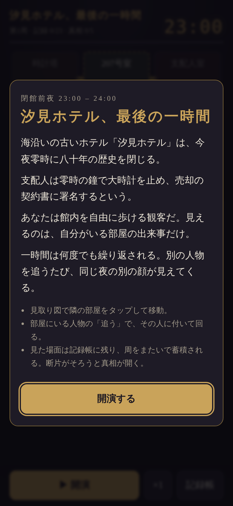
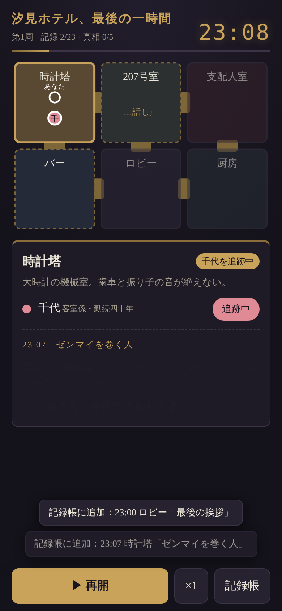
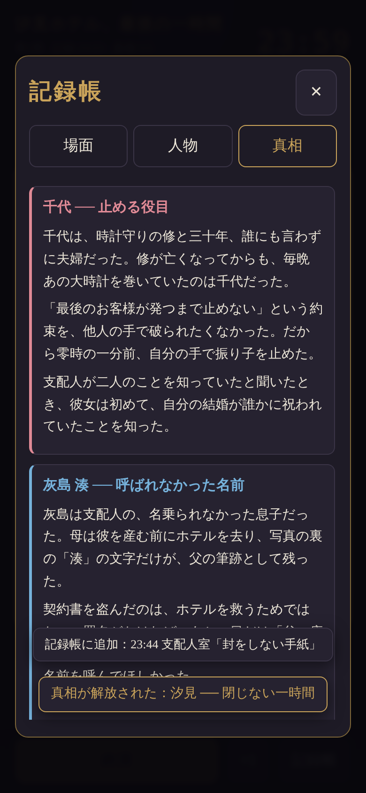
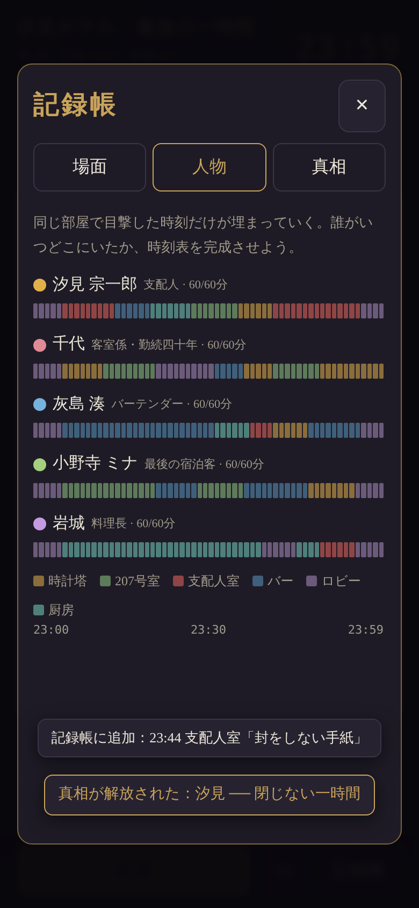

# 最後の一時間 ── 汐見ホテル

観客が館内を自由に歩き、**どの部屋にいるかで見える物語が変わる**イマーシブシアター形式のブラウザゲーム。
閉館前夜の古いホテル（架空）の「23:00〜24:00」の一時間を何度も繰り返し、別の人物を追うたびに同じ夜の別の顔が見えてくる。
主役（支配人）の物語の裏で、周囲の人物たちの嘆きと動機が回収されていく。

- 依存なしの静的 HTML/CSS/JS。GitHub Pages でそのまま動く（スマホ縦優先）。
- 脚本（部屋・人物・時刻表・場面・真相）は JSON に分離。別の公演を足せる。

## 遊び方

| 操作 | 内容 |
|---|---|
| 見取り図の隣の部屋をタップ | 移動（扉でつながった部屋のみ） |
| 人物の「追う」 | その人物の移動に自動で付いていく（もう一度押すと解除） |
| ▶ / ❚❚ | 時計を進める / 止める（スペースキーでも可） |
| ×1 / ×2 / ×4 | 速度。場面が起きている間は自動で等速に落ちる |
| 記録帳 | 見た場面・人物の目撃時刻表・真相・考察メモ |

- 等速で 1 分 = 4 秒、1 周 = 約 4 分。見えるのは自分のいる部屋だけ。隣の部屋で場面が起きていると「…話し声」が漏れ聞こえる。
- 見た場面は記録帳に残り、周をまたいで蓄積（`localStorage`、この端末のみ）。断片がそろうと真相が開く。
- 4 人の脇役の章（千代・灰島・ミナ・岩城）がそろい、支配人室の 2 場面を見ると最終章「閉じない一時間」が開く。最短 5 周。
- 「進み具合を共有」はネタバレなしの進捗文（周回・記録数・解放した章名）を共有シート／クリップボードに渡すだけで、外部送信はしない。

## ローカルで動かす

`fetch` で脚本 JSON を読むので HTTP サーバー経由で開く。

```sh
cd games/immersive-hour
python3 -m http.server 8765
# http://localhost:8765/            通常
# http://localhost:8765/?fast=60    時間を 60 倍速（確認用）
# http://localhost:8765/?s=<id>     公演の切り替え
```

## 構造

```
games/immersive-hour/
├── index.html              画面の骨組み
├── style.css               見た目（暗いホテル調・スマホ縦）
├── app.js                  エンジン（脚本に依存しない）
├── scenarios/
│   ├── index.json          公演一覧 [{ id, file, title }]
│   └── shiomi-hotel.json   公演「汐見ホテル、最後の一時間」
├── tools/
│   ├── timetable.mjs       脚本の整合性チェック + 下の時刻表を出力
│   └── e2e.mjs             Playwright で 5 周・全真相解放を確認
└── screenshots/            e2e が撮るスクリーンショット
```

### エンジンの考え方（app.js）

- 時刻 `t`（0〜60 分）を進め、整数分をまたぐたびに `processMinute` を呼ぶ。
  - 追跡中なら、その人物の時刻表に従ってプレイヤーの部屋を移す。
  - 同じ部屋にいる人物の居場所を「目撃」として記録（記録帳の人物タブ）。
  - その部屋で進行中の場面があれば「見た」として記録 → 真相の解放条件を判定。
- 場面の台詞は `dur` を台詞数で等分して 1 行ずつ現れる。途中から入っても場面は記録される。
- 60 分で終演。周回数を加算し、次の周は 23:00 のロビーから。

### 脚本 JSON の書き方（新しい公演を足すには）

`scenarios/<id>.json` を作り、`scenarios/index.json` に 1 行足す。

| キー | 内容 |
|---|---|
| `id`, `title`, `subtitle`, `intro[]` | 公演の情報とタイトル画面の文 |
| `clockStart` / `length` | 表示上の開始時刻と公演の長さ（分） |
| `rooms[]` | `{ id, name, x, y, tone, desc }`。`x,y` は見取り図のマス目 |
| `doors[]` | `[部屋A, 部屋B]`。上下左右に隣り合うマス同士をつなぐ |
| `characters[]` | `{ id, name, short, role, color }` |
| `schedules{人物id: []}` | `{ t, room, idle }`。`t` 分からその部屋にいる。`idle` は場面がないときの様子 |
| `scenes[]` | `{ id, t, dur, room, chars[], title, lines[{who?, text}] }`。`who` 省略はト書き |
| `truths[]` | `{ id, char, title, hint, requires[], text[], final? }`。`requires` は場面 ID か他の真相 ID |
| `finale` | 終演時、`inRoom` にいたか／`elsewhere` の文 |

`node tools/timetable.mjs scenarios/<id>.json` で、場面の登場人物が本当にその時刻その部屋にいるか、登場しない人物が同室にいないか、などを検査できる。

## 脚本の時刻表（汐見ホテル）

> **ネタバレ注意**：以下は全場面の配置。

### 人物ごとの居場所

| 人物 | 時刻表 |
|---|---|
| 汐見（支配人） | 23:00–23:05 ロビー → 23:05–23:14 支配人室 → 23:14–23:20 バー → 23:20–23:27 厨房 → 23:27–23:35 207号室 → 23:35–23:41 時計塔 → 23:41–23:56 支配人室 → 23:56–24:00 ロビー |
| 千代（客室係・勤続四十年） | 23:00–23:05 ロビー → 23:05–23:12 時計塔 → 23:12–23:21 207号室 → 23:21–23:31 ロビー → 23:31–23:36 バー → 23:36–23:41 時計塔 → 23:41–23:49 207号室 → 23:49–24:00 時計塔 |
| 灰島（バーテンダー） | 23:00–23:05 ロビー → 23:05–23:31 バー → 23:31–23:37 厨房 → 23:37–23:41 支配人室 → 23:41–23:47 時計塔 → 23:47–23:56 バー → 23:56–24:00 ロビー |
| ミナ（最後の宿泊客） | 23:00–23:05 ロビー → 23:05–23:21 207号室 → 23:21–23:28 バー → 23:28–23:36 207号室 → 23:36–23:47 バー → 23:47–23:55 時計塔 → 23:55–24:00 ロビー |
| 岩城（料理長） | 23:00–23:05 ロビー → 23:05–23:39 厨房 → 23:39–23:45 ロビー → 23:45–23:49 厨房 → 23:49–23:55 支配人室 → 23:55–24:00 ロビー |

### 場面一覧

| ID | 時刻 | 部屋 | 登場 | 場面 | 真相 |
|---|---|---|---|---|---|
| S01 | 23:00–23:05 | ロビー | 汐見・千代・灰島・ミナ・岩城 | 最後の挨拶 | — |
| I1 | 23:06–23:10 | 厨房 | 岩城 | 開業の晩のコンソメ | 岩城 |
| C1 | 23:07–23:11 | 時計塔 | 千代 | ゼンマイを巻く人 | 千代 |
| M1 | 23:08–23:12 | 207号室 | ミナ | 真鍮の鍵 | ミナ |
| H1 | 23:09–23:13 | バー | 灰島 | 色褪せた写真 | 灰島 |
| P1 | 23:09–23:13 | 支配人室 | 汐見 | 受話器の向こう | 汐見 |
| H2 | 23:15–23:19 | バー | 灰島・汐見 | 多めの退職金 | — |
| M2 | 23:16–23:20 | 207号室 | 千代・ミナ | 鍵を見た客室係 | — |
| I2 | 23:21–23:26 | 厨房 | 岩城・汐見 | 変えなかった味 | 岩城 |
| M3 | 23:22–23:27 | バー | ミナ・灰島 | 埃をかぶったステージ | ミナ |
| C3 | 23:26–23:30 | ロビー | 千代 | 外された写真 | 千代 |
| M4 | 23:30–23:35 | 207号室 | ミナ・汐見 | 何も言わずに発った人 | ミナ |
| H3 | 23:32–23:37 | 厨房 | 灰島・岩城 | 言わないつもりか | 灰島 |
| C4 | 23:37–23:41 | 時計塔 | 千代・汐見 | 挙げられなかった式 | 千代 |
| H4 | 23:38–23:41 | 支配人室 | 灰島 | 空になった引き出し | 灰島 |
| M6 | 23:38–23:42 | バー | ミナ | 知らない旋律 | — |
| I4 | 23:40–23:44 | ロビー | 岩城 | 六枚目の皿 | 岩城 |
| H5 | 23:43–23:46 | 時計塔 | 灰島 | 振り子の箱 | 灰島 |
| P3 | 23:44–23:49 | 支配人室 | 汐見 | 封をしない手紙 | 汐見 |
| I5 | 23:50–23:55 | 支配人室 | 岩城・汐見 | 知っていた人 | 岩城 |
| M5 | 23:50–23:55 | 時計塔 | ミナ・千代 | 扉の裏の名前 | ミナ |
| C5 | 23:56–24:00 | 時計塔 | 千代 | 止める役目 | 千代 |
| F1 | 23:57–24:00 | ロビー | 汐見・灰島・ミナ・岩城 | 鳴らない鐘 | — |

## 動作確認

```sh
cd games/immersive-hour
python3 -m http.server 8765 &
node tools/e2e.mjs screenshots
```

千代 → ミナ → 灰島 → 岩城 → 汐見の順に追って 5 周し、各章と最終章の解放、隣接しない部屋へ移動できないこと、再読み込み後の記録保持、コンソールエラーなしを確認する。

| タイトル | 追跡中の場面 | 記録帳：真相 | 記録帳：人物 |
|---|---|---|---|
|  |  |  |  |

## 権利

舞台・人物・脚本はすべてこのリポジトリのためのオリジナル。外部画像・フォント・ライブラリは使っていない。
